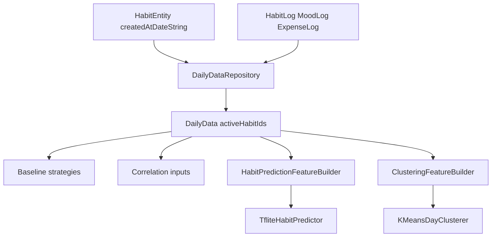

# Active Habit and Feature Builder Refactor

## Goal

Make the analytics layer safe when users add habits after weeks/months of app usage. The key fix is to stop treating “habit did not exist yet” as “habit was missed,” and to stop relying on one universal all-habits vector for every algorithm.

## Current State

- `[app/src/main/java/com/azizov/habitsense/domain/model/DailyData.kt](app/src/main/java/com/azizov/habitsense/domain/model/DailyData.kt)` stores `habitCompletionById`, but not which habits were active on that date.
- `[app/src/main/java/com/azizov/habitsense/data/local/entity/HabitEntity.kt](app/src/main/java/com/azizov/habitsense/data/local/entity/HabitEntity.kt)` already has `createdAtDateString`, which can define whether a habit was active for a date.
- `[app/src/main/java/com/azizov/habitsense/domain/ai/complex/ComplexStrategies.kt](app/src/main/java/com/azizov/habitsense/domain/ai/complex/ComplexStrategies.kt)` currently uses `DailyData.toFloatArray(habitOrder)` in `TfliteHabitPredictor` and `KMeansDayClusterer`.
- Baseline/correlation methods mostly read `DailyData` directly, but they still need active-date handling.

## Design




## Implementation Steps

### 1. Add active-habit semantics to `DailyData`

- Update `[DailyData.kt](app/src/main/java/com/azizov/habitsense/domain/model/DailyData.kt)` to include `activeHabitIds: Set<Long>`.
- Add helper methods:
  - `isHabitActive(habitId)`
  - `completionFor(habitId): Boolean?`
  - `activeHabitCompletionRate()`
- Keep old behavior only where it is still safe; prefer active-aware helpers in analytics.

Essential shape:

```kotlin
fun completionFor(habitId: Long): Boolean? {
    if (habitId !in activeHabitIds) return null
    return habitCompletionById[habitId] ?: false
}
```

### 2. Build `activeHabitIds` in `DailyDataRepository`

- Update `[DailyDataRepository.kt](app/src/main/java/com/azizov/habitsense/data/repository/DailyDataRepository.kt)` to fetch full habits, not just IDs.
- For each date, compute active habits using `HabitEntity.createdAtDateString <= dateString`.
- Build `habitCompletionById` only for active habits, or keep the map full while using `activeHabitIds` as the source of truth.
- Remove the existing ambiguous behavior where every missing habit log becomes a miss regardless of whether the habit existed.

### 3. Fix baseline strategies with active-date helpers

- Update `[BaselineStrategies.kt](app/src/main/java/com/azizov/habitsense/domain/ai/baseline/BaselineStrategies.kt)`:
  - `MovingAverageHabitPredictor`: calculate per-habit rate only from days where `completionFor(habitId) != null`.
  - `HeuristicDayClusterer`: use `activeHabitCompletionRate()` instead of `habitCompletionRate(habitOrder)`.
  - `SpearmanCorrelationAnalyzer`: exclude inactive days from per-habit variable series instead of encoding them as `0f`.

### 4. Add method-specific feature builders

- Add `HabitPredictionFeatureBuilder` under `[domain/ai/feature](app/src/main/java/com/azizov/habitsense/domain/ai/feature)`.
  - Produces fixed-size per-habit windows for TFLite.
  - Input size depends on `windowDays`, not total habit count.
  - Handles new habits with missing/active flags.
- Add `ClusteringFeatureBuilder` under the same package.
  - Produces fixed-size daily summary vectors for K-Means.
  - Uses mood, mood missing flag, expense totals/counts, active completion rate, and active habit count.

### 5. Refactor complex strategies to use builders

- Update `TfliteHabitPredictor` in `[ComplexStrategies.kt](app/src/main/java/com/azizov/habitsense/domain/ai/complex/ComplexStrategies.kt)`:
  - Replace all-habits `toFloatArray(habitOrder)` window with repeated calls to `HabitPredictionFeatureBuilder` per habit.
  - Output one probability per target habit.
  - If model input/output shape is incompatible, fallback to active-aware moving average.
- Update `KMeansDayClusterer`:
  - Replace `dailyData.map { it.toFloatArray(habitOrder) }` with `dailyData.map { clusteringFeatureBuilder.build(it) }`.
  - Keep K-Means implementation itself mostly unchanged.
- Update `AprioriCorrelationAnalyzer`:
  - Skip inactive habits instead of emitting `habit_x_miss` before a habit existed.

### 6. Revisit `FeatureSchema`

- Update `[FeatureSchema.kt](app/src/main/java/com/azizov/habitsense/domain/model/FeatureSchema.kt)` so it no longer presents one all-purpose feature contract.
- Either split into:
  - `HabitPredictionFeatureSchema`
  - `ClusteringFeatureSchema`
- Or keep `FeatureSchema` but clearly separate prediction/clustering dimensions and names.
- Increment schema version because feature semantics change.

### 7. Update tests

- Update existing tests:
  - `[DailyDataFeatureVectorTest.kt](app/src/test/java/com/azizov/habitsense/domain/model/DailyDataFeatureVectorTest.kt)`
  - `[BaselineAndComplexStrategyTest.kt](app/src/test/java/com/azizov/habitsense/domain/ai/baseline/BaselineAndComplexStrategyTest.kt)`
- Add focused tests for:
  - habit added later is not counted as missed before creation date
  - moving average ignores inactive days
  - heuristic clustering uses active completion rate
  - Apriori skips inactive habit items
  - prediction builder output size stays fixed after adding habits
  - clustering builder output size stays fixed after adding habits

### 8. Verification

- Run unit tests and debug build:

```bash
export JAVA_HOME="/Applications/Android Studio.app/Contents/jbr/Contents/Home"
./gradlew test assembleDebug
```

- If lint/build surfaces warnings tied to the refactor, fix only scoped issues.

### 9. Update project rule

- Update `[.cursor/rules/habitsense-thesis-project.mdc](.cursor/rules/habitsense-thesis-project.mdc)` after implementation to document:
  - active habit/date semantics
  - method-specific feature builders
  - TFLite prediction input no longer depending on total habit count
  - K-Means clustering using fixed daily summary vectors

## Expected Outcome

- Adding a new habit no longer corrupts historical analytics.
- Baseline methods remain useful immediately.
- Complex habit prediction no longer requires retraining only because habit count changes.
- K-Means clustering uses stable summary vectors instead of habit-count-dependent vectors.
- Correlation/rule mining stops creating false “missed habit” signals for dates before a habit existed.

